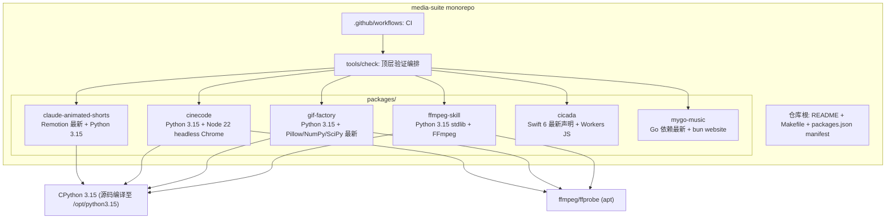

# Media Suite Monorepo

Feature Name: media-suite-monorepo
Updated: 2026-11-21

## Description

将 6 个上游媒体创作项目整合为一个统一 monorepo（仅物理组织，各子包独立使用），Python 子包基于 CPython 3.15 改造，其余子包依赖升级到最新稳定版，并提供共享的构建/测试/文档设施。

## Architecture



仓库布局：

```
/
├── packages/
│   ├── ffmpeg-skill/          # kajisho5/ffmpeg-skill @ main (MIT)
│   ├── gif-factory/           # WoYun520/gif-factory @ main (全量含素材, MIT)
│   ├── cinecode/              # sarpstar/cinecode @ main (MIT)
│   ├── claude-animated-shorts/    # mromidev/claude-animated-shorts @ main (MIT)
│   ├── cicada/                # wquguru/cicada @ main (Apache-2.0)
│   └── mygo-music/            # egoist/mygo-music @ main
├── tools/                     # 顶层验证编排脚本
├── .github/workflows/         # CI
├── packages.json              # 子包清单 manifest
├── Makefile                   # make check / make build
├── README.md                  # 套件总览 + 各包说明 + 构建入口
└── .monkeycode/               # 规格文档
```

## Components and Interfaces

### 1. Python 3.15 工具链（环境基座）

- Debian 12 无 python3.15：从 python.org 源码编译 CPython 3.15.x 安装到 `/opt/python3.15`（`--prefix=/opt/python3.15`，关闭 PGO/LTO 以控制在 2 核 7GB 环境的编译时长）。
- 编译依赖经 `apt-get install` 一次性安装（build-essential、libssl-dev、zlib1g-dev、libffi-dev、libbz2-dev、libreadline-dev、libsqlite3-dev、libncurses-dev、liblzma-dev、tk-dev 等）。
- 全部 Python 子包验证命令统一以 `/opt/python3.15/bin/python3` 运行。
- gif-factory 第三方依赖用该解释器的 venv + pip 安装最新稳定版（Pillow、NumPy、SciPy）。

### 2. 子包迁移

| 子包 | 迁移方式 | 上游记录 |
|---|---|---|
| ffmpeg-skill | 复制除 `.git` 外全部文件 | 上游 URL + commit SHA 写入 packages.json |
| gif-factory | 同上，全量含 1.7GB 素材 | 同上 |
| cinecode | 同上 | 同上 |
| claude-animated-shorts | 同上 | 同上 |
| cicada | 同上 | 同上 |
| mygo-music | 同上 | 同上 |

每个子包目录保留上游 LICENSE；根 README 附"子包与许可一览"表。

### 3. 各子包改造点

**ffmpeg-skill（Python 3.15）**
- 纯 stdlib 代码在 3.15 下做兼容性检查（argparse/subprocess/pathlib 无破坏性变更预期）。
- 需要系统 ffmpeg/ffprobe（apt 安装）运行其工具与部分测试。
- 其 `requirements: 无第三方依赖` 保持不变，符合 3.15 基线即可。

**gif-factory（Python 3.15 + 依赖最新）**
- venv 内安装最新 Pillow/NumPy/SciPy，逐个冒烟运行 `scripts/*.py --help`。
- NumPy 2.x API 变更（如 `np.float_` 移除等）按需改写调用点。

**cinecode（Python 3.15 + Node/CDN 栈最新）**
- Python 脚本 stdlib only，3.15 冒烟 `--help`。
- capture.mjs 零 npm 依赖，Node 22 可直接运行（`--probe` 需 Chrome，本环境无 GUI 时跳过实际渲染，仅语法/干跑验证）。
- 模板中 three.js CDN 版本引用统一升级到最新 stable r-release。

**claude-animated-shorts（Remotion 最新 + Python 3.15）**
- 上游不带 package.json：SKILL.md 文档中的 Remotion/@remotion/three 版本引用更新到最新 stable；模板源码保持兼容。

**cicada（Swift 声明升级 + Workers 局部验证）**
- `Package.swift` swift-tools-version 检查并升级到 Swift 6 工具链最新；平台要求维持上游值。
- server/（Cloudflare Workers）compatibility_date 检查升级；本地用其自带 test 或 wrangler 干跑验证。
- Swift GUI 构建不在本环境执行（留待 macOS），在子包 README 标注。

**mygo-music（Go 依赖最新）**
- `go get -u ./...` 升级全部依赖到最新稳定版，`go mod tidy`。
- `go build ./...` + `go test ./internal/...` 验证；GUI 运行时依赖（图形栈）不适用于 headless 环境，以编译+测试通过为验收。

### 4. 共享工程设施

- `packages.json` manifest：每包 `{name, path, language, buildCmd, testCmd, upstream, license}`。
- `Makefile`：`build`（逐包构建）、`check`（逐包构建+测试/冒烟）、单包目标 `check-<pkg>`。
- CI workflow 复用同一 Makefile 目标。
- 根 README：套件总览、子包表格（功能/语言/构建/许可/上游）、工具链前置条件说明。

## Data Models

`packages.json` 示例：

```json
{
  "packages": [
    {
      "name": "ffmpeg-skill",
      "path": "packages/ffmpeg-skill",
      "language": "python",
      "python": "3.15",
      "upstream": "https://github.com/kajisho5/ffmpeg-skill",
      "upstreamCommit": "<sha>",
      "license": "MIT",
      "buildCmd": "true",
      "testCmd": "/opt/python3.15/bin/python3 -m unittest discover -s tests"
    }
  ]
}
```

## Correctness Properties

1. 每个子包对外行为与上游兼容（迁移为纯复制 + 兼容性改写，无功能删减）。
2. 所有 Python 子包在 CPython 3.15 解释器下通过冒烟/测试。
3. Go 子包 `go build ./...` 与 `go test ./internal/...` 通过，依赖为升级后最新稳定版。
4. 每个 LICENSE 与上游一致；packages.json 记录的上游地址与 commit 准确。
5. 顶层 `make check` 对每个子包给出明确的 PASS/SKIP(原因)/FAIL 结果。

## Error Handling

- 某子包构建失败：`make check` 继续其余子包，最终汇总失败清单，退出码非零。
- 环境缺依赖（如 Chrome、GUI 库）：该验证项标记 SKIP 并注明原因，而非中断。
- Python 3.15 编译失败：回退重试一次（清理后重建），仍失败则上报用户。

## Test Strategy

| 子包 | 验证方式 |
|---|---|
| ffmpeg-skill | 部分自带测试（需 ffmpeg）+ 全工具 `--help` 冒烟 |
| gif-factory | venv 最新 Pillow/NumPy 下 `scripts/*.py --help` 冒烟 |
| cinecode | Python 脚本 `--help` 冒烟 + capture.mjs node 语法检查 |
| claude-animated-shorts | 文档型 Skill：结构完整性检查（SKILL.md、templates 存在） |
| cicada | server 目录测试/干跑 + Package.swift 结构校验 |
| mygo-music | `go vet` + `go build ./...` + `go test ./internal/...` |

## References

- 上游仓库：kajisho5/ffmpeg-skill、WoYun520/gif-factory、sarpstar/cinecode、mromidev/claude-animated-shorts、wquguru/cicada、egoist/mygo-music
- requirements: .monkeycode/specs/media-suite-monorepo/requirements.md
